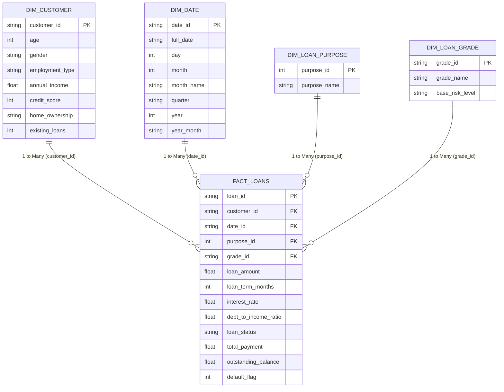

# Star Schema Data Model Documentation & ER Architecture

**Project No. 6:** Loan Default Analysis and Risk Dashboard  
**Domain:** Banking & Financial Services  
**Warehouse Architecture:** Kimball Dimensional Modeling (Star Schema)  

---

## 1. Dimensional Architecture Diagram (Mermaid)

---

## 2. Table Specifications & Cardinalities

### 1. `FACT_LOANS` (Fact Table)
- **Granularity:** One record per disbursed loan contract.
- **Primary Key:** `loan_id` (Unique alphanumeric string e.g. `LN-100001`).
- **Foreign Keys:**
  - `customer_id` $\rightarrow$ `DIM_CUSTOMER(customer_id)` (Many-to-One, Single directional filter)
  - `date_id` $\rightarrow$ `DIM_DATE(date_id)` (Many-to-One, Single directional filter)
  - `purpose_id` $\rightarrow$ `DIM_LOAN_PURPOSE(purpose_id)` (Many-to-One, Single directional filter)
  - `grade_id` $\rightarrow$ `DIM_LOAN_GRADE(grade_id)` (Many-to-One, Single directional filter)
- **Measures / Metrics:** `loan_amount`, `interest_rate`, `debt_to_income_ratio`, `total_payment`, `outstanding_balance`, `default_flag`.

### 2. `DIM_CUSTOMER` (Dimension Table)
- **Granularity:** One record per unique borrower.
- **Primary Key:** `customer_id`.
- **Attributes:** Demographics (`age`, `gender`, `employment_type`), Financial Capacity (`annual_income`), Credit Standing (`credit_score`, `existing_loans`), Collateral (`home_ownership`).

### 3. `DIM_DATE` (Dimension Table)
- **Granularity:** One record per calendar day.
- **Primary Key:** `date_id` (Formatted `YYYY-MM-DD`).
- **Attributes:** `full_date`, `day`, `month`, `month_name`, `quarter`, `year`, `year_month`.

### 4. `DIM_LOAN_PURPOSE` (Dimension Table)
- **Granularity:** One record per standardized expenditure category.
- **Primary Key:** `purpose_id`.
- **Attributes:** `purpose_name` (`Debt Consolidation`, `Credit Card`, `Home Improvement`, `Small Business`, etc.).

### 5. `DIM_LOAN_GRADE` (Dimension Table)
- **Granularity:** One record per credit rating tier (A, B, C, D, E, F, G).
- **Primary Key:** `grade_id`.
- **Attributes:** `grade_name` (`Grade A Prime`, `Grade B Near Prime`, etc.), `base_risk_level`.

---

## 3. Step-by-Step Instructions: How to Draw in Draw.io

1. Open [draw.io](https://app.diagrams.net/) in your web browser.
2. Select **Create New Diagram** $\rightarrow$ **Blank Diagram**.
3. In the left panel, search for **Entity Relation** shape library.
4. Drag 5 `Entity` table shapes onto the canvas.
5. Place `FACT_LOANS` in the center of the canvas.
6. Position the 4 dimension tables around `FACT_LOANS` in a star formation:
   - `DIM_CUSTOMER` at the Top-Left.
   - `DIM_DATE` at the Top-Right.
   - `DIM_LOAN_PURPOSE` at the Bottom-Left.
   - `DIM_LOAN_GRADE` at the Bottom-Right.
7. Fill table headers with Dark Navy `#0A192F` for Fact and Deep Slate `#1E3A8A` for Dimensions.
8. Connect each dimension to the fact table using standard `1 to Many` crow's foot connector lines.
9. Export diagram as PNG or SVG: **File $\rightarrow$ Export as $\rightarrow$ PNG**.

---

## 4. SQLite vs. Oracle SQL Implementation Differences

| Feature | SQLite 3 Local Implementation | Oracle Enterprise (19c/21c) Implementation |
|:---|:---|:---|
| **Data Types** | Dynamic typing (`TEXT`, `REAL`, `INTEGER`) | Strict static typing (`VARCHAR2`, `NUMBER(p,s)`, `DATE`) |
| **Date Storage** | ISO-8601 strings (`TEXT` as `YYYY-MM-DD`) | Native `DATE` with day/month/year/time precision |
| **Foreign Keys** | Disabled by default; requires `PRAGMA foreign_keys = ON;` | Enabled and enforced via `CONSTRAINT ... FOREIGN KEY` |
| **Window Functions** | Supported since SQLite 3.25 (`LAG(...) OVER (...)`) | Fully supported enterprise analytics engine |
| **Null Handling** | `NULLIF(val, 0)` | `NULLIF(val, 0)` or `NVL(...)` |
| **Auto-Increment** | `INTEGER PRIMARY KEY AUTOINCREMENT` | `NUMBER GENERATED BY DEFAULT AS IDENTITY` or Sequence |
